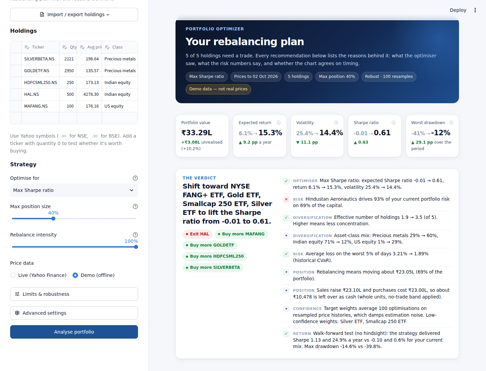

# Portfolio Optimizer

Optimises a stock/ETF portfolio and **explains every recommendation**: what to buy, trim or exit, how
many units, and the reasons behind each move. Runs as an interactive dashboard, a command-line
report, or a notebook.



## Quick start

```bash
pip install -r requirements.txt
streamlit run app.py            # dashboard at http://localhost:8501
python -m portfolio_optimizer   # text report in the terminal
python -m portfolio_optimizer --demo   # same, with synthetic prices (no internet)
```

Edit your holdings in the sidebar, or import them from a CSV (`Ticker, Qty, Avg price`, optional `Class`)
via **Import / export holdings**. Tickers use Yahoo Finance symbols (`.NS` for NSE, `.BO` for BSE).
Add a ticker with quantity 0 to see whether it's worth buying. Position, asset-class and turnover limits,
the no-trade band and robust resampling are under **Limits & robustness**.

## What you get

| Tab | What it shows |
|---|---|
| **Verdict** | One-line recommendation plus the portfolio-level case for rebalancing |
| **Action plan** | Trade list in units and rupees (CSV download), each holding's exact share of the improvement, and a card per holding with its reasons |
| **Allocation** | Current vs target weights, asset-class mix, concentration metrics |
| **Risk** | Share of capital vs share of risk, correlation heatmap, drawdowns, VaR/CVaR/Sortino/beta |
| **Efficient frontier** | Random portfolios, the frontier under your limits, the capital market line, current → target |
| **Compare strategies** | Every strategy's optimum under the same limits: Sharpe, volatility and worst-day loss side by side, plus weights |
| **What-if** | Type your own weights and see them scored against your current mix and the plan, with limit checks |
| **Technicals** | Price with 50/200-day averages and Bollinger bands, RSI, MACD, and a −100…+100 score |
| **Backtest** | Walk-forward test with no hindsight vs your current mix, equal weight and Nifty 50 |

### The reasons

Every holding gets reasons in four groups:

- **Optimiser.** Why the weight moves. This comes from an exact attribution: the objective's gradient is
  integrated along the path from your current to your target weights, so each holding's contribution
  adds up to the total change (e.g. *"Adding it raises the Sharpe ratio by 0.163 of the 0.644 total
  improvement"*). The explanation can't contradict the action.
- **Risk & diversification.** Risk share vs capital share, correlation with the rest of the portfolio,
  worst drawdown, position-cap effects.
- **Timing.** RSI, MACD, trend, Bollinger bands and momentum. These suggest *when* to trade (now,
  stagger, wait for a dip), never *how much*.
- **Your position.** Unrealised P&L against your average cost, plus capital-gains and loss-offset notes.

## Strategies

- **Max Sharpe ratio**: best expected return per unit of risk, above the risk-free rate.
- **Minimum volatility**: the smoothest ride.
- **Minimum tail risk (CVaR)**: smallest average loss on the worst 5% of days, solved exactly as a
  linear program (Rockafellar–Uryasev) on historical returns.
- **Risk parity**: each holding contributes the same share of portfolio risk.
- **Max diversification**: holdings whose swings offset each other.

All are long-only and fully invested. A *rebalance intensity* slider lets you move part of the way
toward the target.

### Limits

- **Position size**: min/max weight per holding.
- **Asset class**: max total weight per class (e.g. precious metals ≤ 50%). Classes come from the
  holdings' `class` field, with sensible defaults for known tickers.
- **Turnover**: max share of the portfolio traded in one rebalance. If your other limits alone need
  more trading than that, you get the exact minimum instead of a vague failure.
- **No-trade band**: skip trades that move a weight by less than this (default 2 pp).

### Robust weights

Expected returns and correlations are noisy, so a single optimisation over-reacts to them. By default
the target is the average of 100 optimisations on **block-bootstrapped** price histories (Michaud
resampling). Each holding also gets a 10th–90th percentile range and a **confidence** level, shown
among its reasons. Weights that your limits pin down are reported as such.

### Command line

```bash
python -m portfolio_optimizer --strategy min_cvar --max-weight 0.4 --class-cap 0.5 --max-turnover 0.3
python -m portfolio_optimizer --no-robust --no-trade-band 0.03 --demo
```

## What changed from the original notebook

The original is kept at `notebooks/Portfolio_Optimiser_original.ipynb`.

| Original | Now |
|---|---|
| Sharpe ratio with a 0% risk-free rate | Measured against a 6.5% risk-free rate (adjustable), so assets must beat T-bills |
| Raw historical mean returns: the optimiser chases whatever rallied most | Bayes–Stein shrinkage of expected returns |
| Sample covariance | Ledoit–Wolf shrinkage of correlations |
| No position limits (could put 45% in one ETF) | Min/max weights with a feasibility check |
| RSI with a simple moving average | Wilder's RSI (the standard definition), MACD with `adjust=False` |
| Bollinger bands computed but never used | Used in the signal score |
| Optimal weights only | Units to buy/sell, rupee amounts, timing, CSV export |
| No explanation | Reasons for every holding plus a portfolio-level verdict |
| In-sample results only | Walk-forward backtest with trading costs |
| `pct_change` FutureWarning, NaN prices on holidays | Calendars aligned, explicit `fill_method=None` |

## Project layout

```
app.py                         Streamlit dashboard
portfolio_optimizer/
  data.py                      Yahoo Finance download + offline demo data
  analytics.py                 Estimators, risk metrics, attribution
  optimizer.py                 Strategies, limits, CVaR LP, resampling, frontier
  indicators.py                RSI, MACD, Bollinger, signal score
  reasons.py                   Actions and plain-English reasons
  backtest.py                  Walk-forward backtest
  report.py                    analyze(): runs everything
  charts.py                    Plotly figures (app + notebook)
  ui.py                        Dashboard styling and HTML components
notebooks/                     Updated notebook + the original
tests/                         pytest suite
```

Run the tests with `pip install -r requirements-dev.txt && pytest`.

## Caveats

Expected returns are estimated from past prices and are the least reliable input, even after
shrinkage. Taxes, exit loads and lot sizes are not modelled. **Educational tool, not investment advice.**
